# PDF Password Cracking Lab — Dictionary Attacks

**Course:** Networkwalks Academy — Cybersecurity & Ethical Hacking
**Week 3 Lab:** Cracking password‑protected PDFs using dictionary attacks
**Environment:** Kali Linux

## Objective

The goal of this lab was to understand how password‑protected PDF files can be
broken using a **dictionary attack**, by extracting a crackable hash from the
PDF and testing it against a wordlist. The lab had two parts:

- **Task 1** — Crack the PDFs using **John the Ripper** (command line) on Kali Linux.
- **Task 2** — Crack a PDF using the **Networkwalks "Hash Calculator" + "Password Cracker"** web tools, which simulate the same dictionary‑attack logic in the browser.

> ⚠️ **Disclaimer:** This was a controlled, educational CTF‑style lab using
> sample PDFs provided by the course (Networkwalks Academy). The techniques
> here should only be used on files you own or are authorized to test.

---

## Task 1 — Cracking with John the Ripper

### Step 1: Update system and install John the Ripper

```bash
sudo apt update
sudo apt install john
```

John the Ripper (jumbo version) was already installed on the Kali machine.

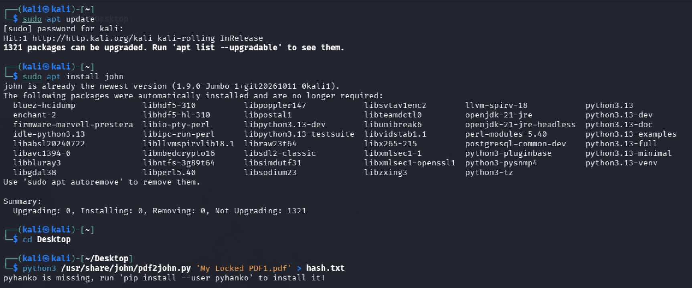

### Step 2: Extract a crackable hash from the PDF

John the Ripper ships with a helper script, `pdf2john.py`, which extracts the
PDF's encryption data into a hash format John can attack:

```bash
cd Desktop
python3 /usr/share/john/pdf2john.py 'My Locked PDF1.pdf' > hash1.txt
```

The script initially complained that **pyhanko** was missing, so a Python
virtual environment was created and the dependency installed:

```bash
python3 -m venv ~/pdf-env && source ~/pdf-env/bin/activate && pip install pyhanko
python3 /usr/share/john/pdf2john.py 'My Locked PDF1.pdf' > hash1.txt
```

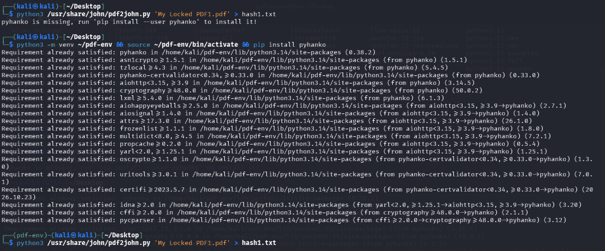

The same process was repeated for `My Locked PDF2.pdf` and
`My Locked PDF3.pdf`, producing `hash2.txt` and `hash3.txt`.

Example of the extracted hash (PDF, MD5‑RC4 / SHA2‑AES, 128‑bit key):

```
$pdf$4*4*128*-1028*1*16*ca7f72f11459cba469f1005a8765ed51*32*f32d8fa1bfbe2648226dffc39f7909ea...
```

### Step 3: Run the dictionary attack

Each hash file was attacked with John the Ripper using the well‑known
`rockyou.txt` wordlist:

```bash
john --wordlist=/usr/share/wordlists/rockyou.txt hash1.txt
john --wordlist=/usr/share/wordlists/rockyou.txt hash2.txt
john --wordlist=/usr/share/wordlists/rockyou.txt hash3.txt
```

**Results:**

| PDF File | Cracked Password |
|---|---|
| My Locked PDF1.pdf | *(cracked — hash1, shown in pot file)* |
| My Locked PDF2.pdf | `password1` |
| My Locked PDF3.pdf | `1qaz2wsx` |

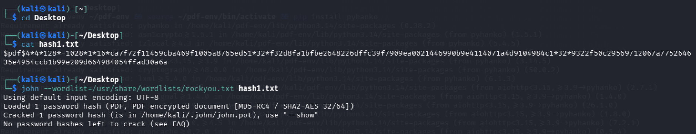
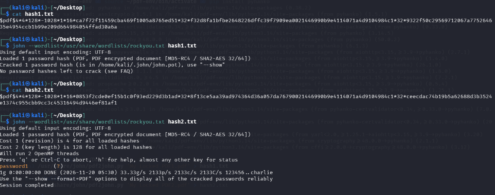
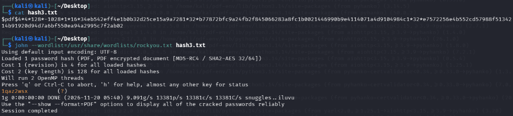

### Step 4: Open the PDFs and capture the flags

Using the recovered passwords, each PDF was unlocked and opened, revealing a
unique CTF flag:

- **PDF1:** `nw{cybersecurity_flag_captured_2608}`
- **PDF2:** `nw{networkwalks_persistence_jtr_270521}`
- **PDF3:** `nw{networkwalks_flag_260821_1}`

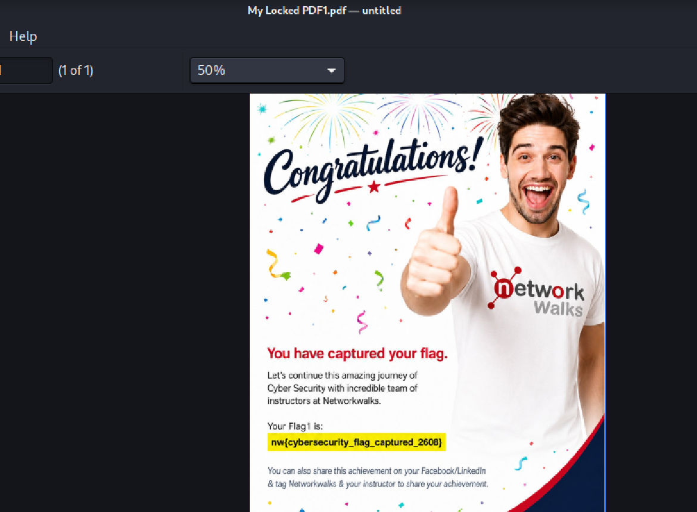
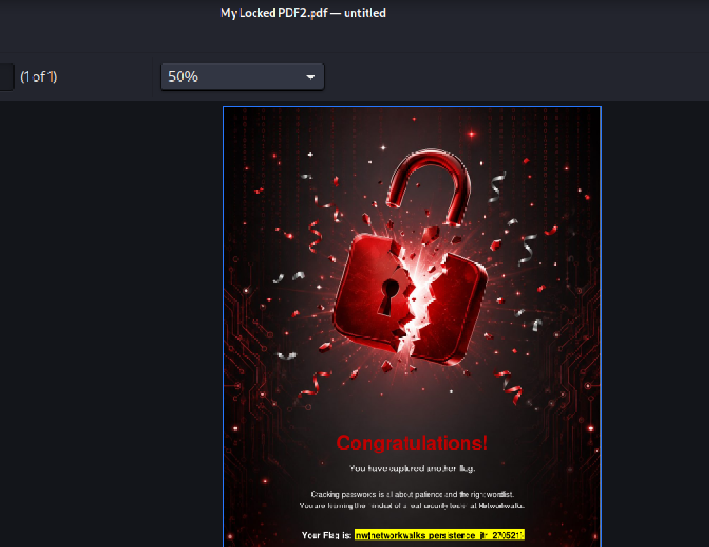
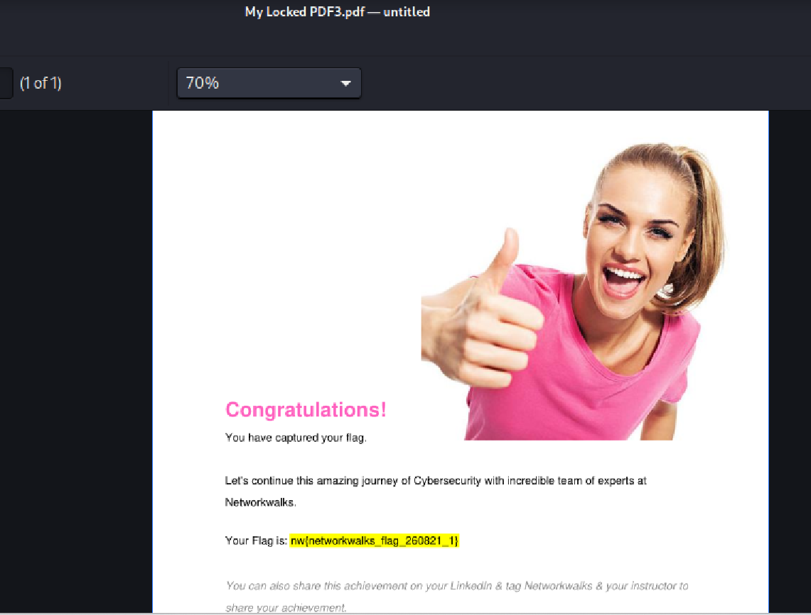

---

## Task 2 — Cracking with the Networkwalks Online Tool

This task repeated the same concept using Networkwalks Academy's browser‑based
tools instead of the command line.

### Step 1: Extract the hash with the "Hash Calculator" tool

The locked PDF (`My Locked PDF1 (for NW Tools Lab WK3-PM2).pdf`) was uploaded
to the **Hash Calculator** tool, which parses the PDF locally (nothing
uploaded to a server) and returns a `pdf2john` / hashcat‑compatible hash:

```
$pdf$4*4*128*-1060*1*16*55d1a5c14175da449753199e44971d32*32*777fd021a7f3c5ae598c0c6495c7f76e00...*32*ceecdac74b19b5a62688d3b3524e1374c955cbb9cc3c45316494d9446ef81af1
```

Details reported: **Revision R4, Version V4, Key length 128‑bit**.

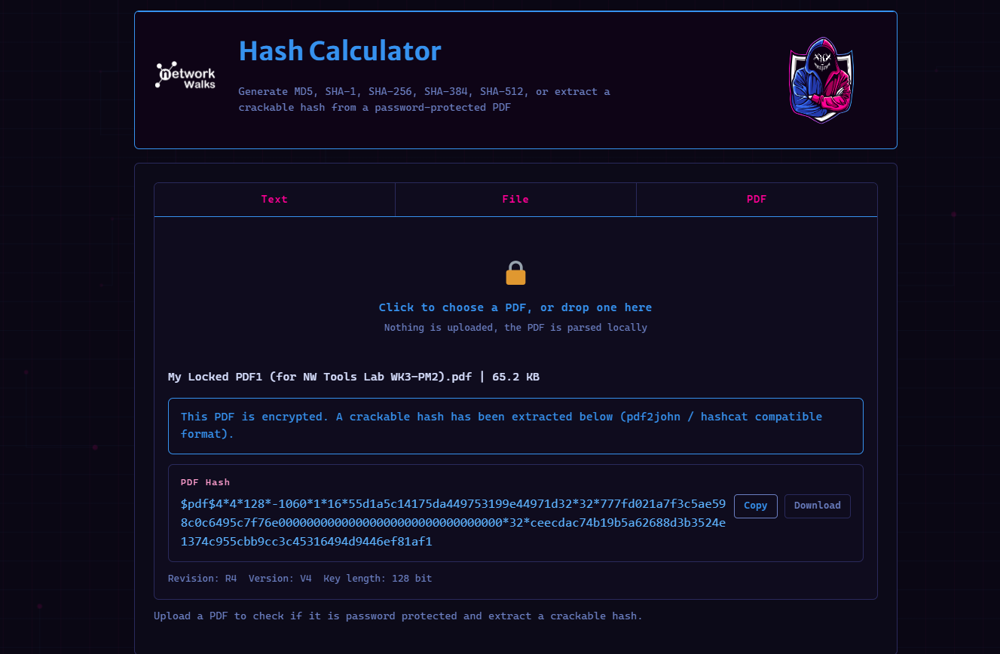

### Step 2: Run the dictionary attack with the "Password Cracker" tool

The extracted `$pdf$...` hash was pasted into the **Password Cracker** tool
(Dictionary Attack Lab), which tested it against a 100‑word built‑in password
list:

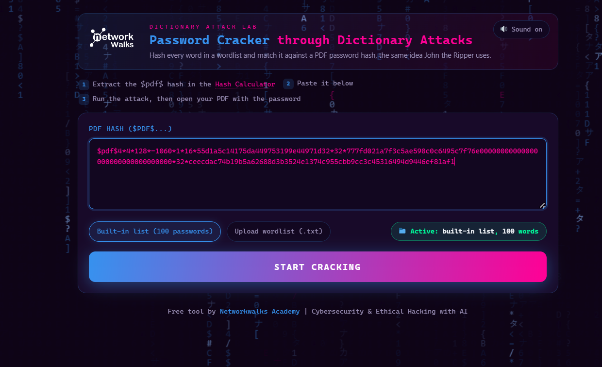

The tool tried each candidate password in sequence (`service`, `canada`,
`hockey`, `killer`, `george`, `asdfgh`, `zxcvbn`, `qwertyuiop`, `111222`...)
until it found a match on attempt 91/100:

```
[+] MATCH password1 ✓
PASSWORD CRACKED SUCCESSFULLY: password1
```

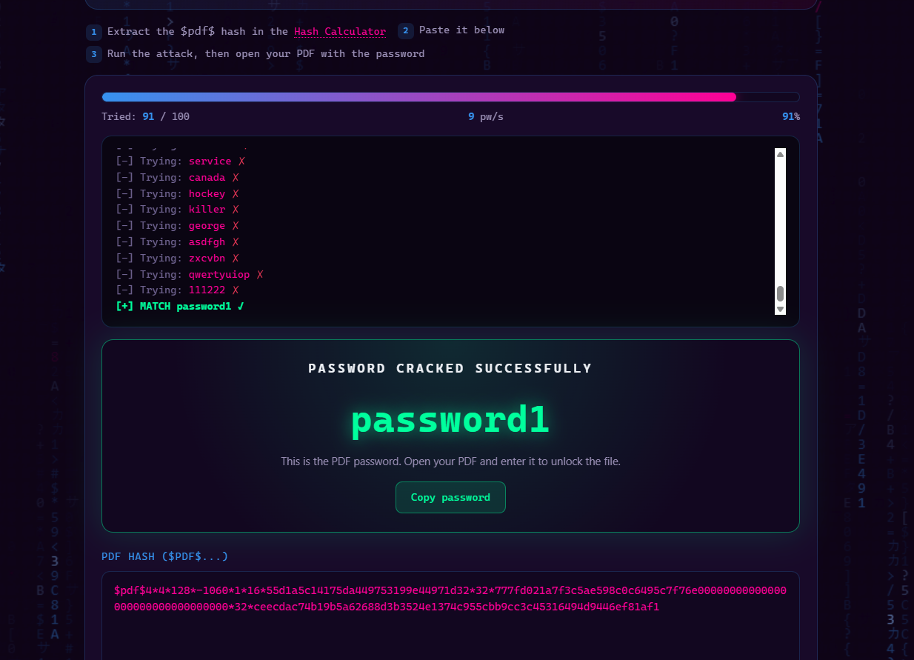

### Step 3: Open the PDF and capture the flag

Entering `password1` unlocked the PDF, revealing:

- **Flag:** `nw{networkwalks_flag1_jtr_270521_1}`

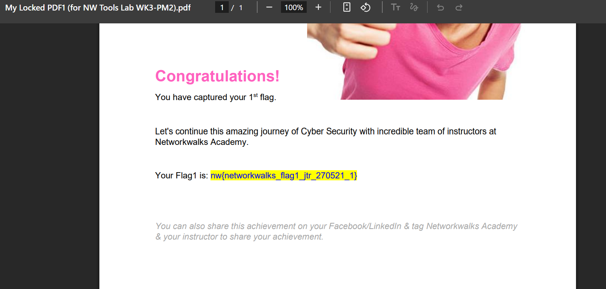

---

## Summary

| Task | Tool Used | Technique | Password Recovered | Flag Captured |
|---|---|---|---|---|
| 1 (PDF1) | John the Ripper | Dictionary attack (rockyou.txt) | Cracked ✔ | `nw{cybersecurity_flag_captured_2608}` |
| 1 (PDF2) | John the Ripper | Dictionary attack (rockyou.txt) | `password1` | `nw{networkwalks_persistence_jtr_270521}` |
| 1 (PDF3) | John the Ripper | Dictionary attack (rockyou.txt) | `1qaz2wsx` | `nw{networkwalks_flag_260821_1}` |
| 2 | Networkwalks Hash Calculator + Password Cracker | Dictionary attack (100‑word list) | `password1` | `nw{networkwalks_flag1_jtr_270521_1}` |

## Key Takeaways

- A password‑protected PDF's encryption metadata can be converted into an
  offline, crackable hash using `pdf2john.py` — the PDF itself never needs to
  be "guessed against" online, which makes dictionary attacks extremely fast.
- Weak, common passwords (`password1`, `1qaz2wsx`) are cracked almost
  instantly against a large wordlist like `rockyou.txt`, reinforcing why
  predictable passwords are a major security risk.
- The same dictionary‑attack logic used by John the Ripper can be
  re‑implemented in a simple web tool, showing that the *concept* (hash
  extraction → candidate testing → match) matters more than any one specific
  tool.
- This reinforces the importance of using long, random, unique passwords for
  any sensitive or encrypted document.
